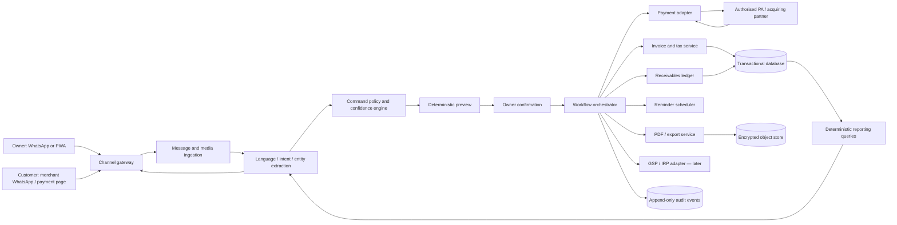

# Architecture and security blueprint

## Architecture objective

Build a financial workflow system with conversational interfaces—not a chatbot that happens to write to a database. The source of truth is a controlled, auditable transaction system. WhatsApp, PWA, voice, and future channels are adapters.

## Reference architecture

## Channel strategy

### Pilot

1. Owner uses a central assistant conversation or PWA chat.
2. System generates draft/PDF/payment artefact.
3. Owner taps to share using the merchant’s existing WhatsApp Business app.
4. Payment is manually recorded or received from a merchant-owned provider integration.

This minimises onboarding and template dependencies while testing the core value loop.

### Paid automation tier

1. Merchant completes Meta embedded signup and connects a business-owned number.
2. Where available and suitable, Business App/Platform coexistence preserves normal mobile use.
3. Consent and template state are stored per customer and purpose.
4. Scheduled utility reminders are sent from the merchant’s identity.
5. Delivery, failure, inbound response, and opt-out events update the workflow.

### Platform-risk rule

No core financial record may become inaccessible because WhatsApp is unavailable or the account is restricted. The PWA must support invoice creation, receivables queries, exports, and integration management.

## Recommended build shape

Start as a **modular monolith**, not microservices. Use clear domain modules and an outbox/event pattern so high-risk integrations can later separate without distributed-system overhead.

Suggested modules:

- identity and tenancy;
- business/customer/item masters;
- conversation/command interpretation;
- invoice and tax;
- documents;
- receivables and payments;
- reminders and communications;
- reporting/export;
- integrations;
- audit/compliance;
- billing/entitlements;
- support/admin with strong access controls.

## Suggested technology profile

Vendor choice should follow the team’s strengths, but a pragmatic reference stack is:

- typed backend: TypeScript/NestJS or Python/FastAPI with strict schemas;
- PostgreSQL with exact numeric types and tenant isolation;
- Redis for short-lived locks/rate limits, not financial truth;
- durable job queue for PDFs, messages, exports, and webhooks;
- S3-compatible encrypted object storage in an appropriate Indian region;
- React/Next.js PWA with offline draft queue;
- managed key/secrets service;
- infrastructure as code;
- India-resident log archive for applicable CERT-In retention;
- vendor-abstracted LLM and speech interfaces;
- OpenTelemetry-compatible tracing with personal/financial-data redaction.

## Core transaction pattern

### Example: create invoice

1. Assign an inbound event ID and reject duplicates.
2. Transcribe voice if needed.
3. Convert text into a typed `CreateInvoiceDraft` proposal.
4. Resolve candidate master data without silently creating duplicates.
5. Run deterministic validation and tax calculation.
6. Store draft plus model/provider/version/confidence.
7. Present a human-readable preview.
8. Receive explicit confirmation tied to draft hash/version.
9. In one database transaction:
   - allocate financial-year invoice number;
   - persist immutable invoice version;
   - post receivable entry;
   - update item quantity only if that module is enabled;
   - append audit events;
   - write integration outbox events.
10. Workers generate PDF, payment artefact, and share action.

If a worker fails, the invoice remains posted and can be retried. It is not recreated.

## Tax engine

The tax engine is versioned and testable. Inputs include:

- supplier GST status/type and state;
- recipient registration and state;
- place of supply;
- invoice/document type;
- line HSN/SAC and confirmed tax treatment;
- price inclusive/exclusive flag;
- quantity, unit, discounts, cess where relevant;
- reverse-charge/export/SEZ flags when supported;
- invoice date and rule/rate version.

Outputs include exact line and document totals, CGST/SGST/UTGST/IGST/cess breakdown, validation errors, warnings, and rule-version metadata.

The LLM never chooses a tax rate silently. A suggested classification is marked as unverified until accepted or supplied by an authoritative mapping/integration.

## Receivables ledger

Use double-entry-compatible event concepts even before offering full accounting:

- invoice posts receivable and sales/tax control entries;
- receipt posts cash/clearing and reduces receivable through allocation;
- partial receipt allocates an exact amount;
- credit note reduces receivable through a new document;
- cancellation/reversal is a compensating event, not a row delete;
- write-off requires owner privilege, reason, and audit event;
- provider settlement is separate from customer payment status.

Materialised balances are projections rebuilt from ledger events and regularly reconciled.

## Payment integration modes

### Mode A: direct UPI intent/QR

- exact amount and merchant reference where supported;
- money goes directly to merchant;
- no claim of automatic reconciliation;
- user records payment or imports later evidence.

### Mode B: merchant-owned PA account

- OAuth/API credentials or partner connection stored as encrypted references;
- payment link/QR tied to invoice reference;
- signed webhook changes payment state;
- fetch API used to verify uncertain terminal states;
- merchant receives settlements directly from authorised provider;
- fees and settlement terms disclosed by provider.

### Webhook rules

- preserve raw body for signature verification;
- validate timestamp and signature;
- unique constraint on provider event/payment ID;
- acknowledge quickly and process asynchronously;
- handle out-of-order events;
- reconcile success, failure, partial, refund, reversal, dispute, and settlement separately;
- never trust redirect/callback alone as final proof.

## WhatsApp integration controls

- official Cloud API/approved provider only; no browser automation or unofficial libraries;
- merchant authorisation and data-processing agreement;
- approved template registry with language and version;
- opt-in source, timestamp, purpose, and proof;
- 24-hour/service-window state where applicable;
- stop/opt-out keywords in supported languages;
- frequency caps and quiet hours;
- quality-rating and failure monitoring;
- configurable per-message cost ledger;
- global and per-merchant kill switch;
- data minimisation: do not send internal notes or unnecessary financial history.

The owner-facing assistant workflow needs a specific Meta/BSP policy review because current terms restrict general-purpose AI distribution while permitting many business-scoped automations. Keep the assistant narrowly task-oriented and retain the PWA route.

## AI system design

### Pipeline

1. language and script detection;
2. ASR/transliteration where relevant;
3. intent classification;
4. constrained structured extraction;
5. entity resolution against tenant-scoped masters;
6. deterministic validation;
7. uncertainty/clarification policy;
8. preview and confirmation;
9. authorised tool execution;
10. deterministic response data plus natural-language rendering.

### Provider strategy

Use an abstraction and benchmark:

- one strong general model for structured reasoning/extraction;
- an Indic-specialist speech/language provider such as BHASHINI/Sarvam/AI4Bharat-derived service where it wins;
- optional smaller model for cheap classification;
- no sensitive prompt logging at providers unless contractually controlled;
- explicit data-processing and retention review for every provider.

### Golden evaluation set

Build at least 200 de-identified, consented utterances across:

- Hindi, Hinglish, English;
- Devanagari and Latin scripts;
- Indian number words and lakh/crore units;
- noisy voice notes;
- customer names and abbreviations;
- quantities, units, discounts, inclusive tax;
- negation and corrections;
- multiple line items;
- ambiguous dates;
- intra/inter-state scenarios;
- payment and reminder requests.

Measure exact field accuracy, money accuracy, clarification rate, false-write rate, latency, and cost. A fluent response with a wrong number is a failure.

### Prompt-injection boundary

Customer messages, invoice notes, uploaded documents, and webhook text are untrusted data. They cannot alter system policy, select tools, change permissions, or cause a financial write. Tool access is decided by server-side policy on a typed command.

## Security baseline

### Identity and access

- OTP/passkey or strong authentication for owners;
- step-up confirmation for exports, integration changes, write-offs, and account deletion;
- tenant-scoped roles and least privilege;
- support access is time-bound, approved, and audited;
- CA access is read-only by default;
- session/device list and remote revoke.

### Data protection

- TLS for all transport;
- encryption at rest for database, objects, and backups;
- field-level protection for integration tokens and high-risk identifiers;
- managed key rotation;
- production/test separation;
- de-identified analytics;
- retention schedule by data class;
- data-subject request and merchant export workflows;
- vendor/subprocessor register.

### Application controls

- tenant ID derived from authenticated context, never user-provided alone;
- object-level authorisation tests;
- strict file type/size scanning;
- PDF generation sandbox;
- SSRF protection for remote media;
- rate limiting and abuse detection;
- signed URLs with short expiry;
- dependency and container scanning;
- SAST/DAST and annual independent assessment before scale;
- fraud and anomalous financial-action alerts.

### Audit events

Record actor, tenant, action, object, prior/new version reference, time, channel, request/event ID, confirmation ID, integration/model version where relevant, and reason. Audit events are append-only and access controlled. Sensitive values should be referenced or hashed where full copies are unnecessary.

## Reliability and disaster recovery

- transactional outbox for external side effects;
- idempotency keys on all financial writes;
- queue retries with dead-letter review;
- provider circuit breakers;
- daily encrypted backups plus point-in-time recovery;
- quarterly restore drill in beta, more frequently after scale;
- documented RPO/RTO: initial target RPO ≤15 minutes, RTO ≤4 hours;
- PDF/document regeneration from immutable invoice data;
- reconciliation jobs for ledger projections, payments, and outbound messages;
- status page and incident communication path.

## Environments and delivery

1. Local/developer with synthetic data only.
2. Shared test with sandbox WhatsApp/payment/GSP accounts.
3. Pilot production isolated from test.
4. Feature flags per tenant and vertical.
5. Database migrations reviewed for reversibility and financial-history safety.
6. Canary rollout for model/prompt/tax-engine changes.
7. Every model or prompt release runs the golden evaluation set.

## Build roadmap

### Sprint 0: two weeks

- schemas and tax scenario catalogue;
- clickable prototype;
- WhatsApp/BSP policy validation;
- CA review;
- golden utterance collection design;
- threat model and data map.

### Concierge prototype: four to six weeks

- PWA conversation;
- customer/item masters;
- deterministic invoice draft and PDF;
- direct UPI QR;
- receivables and manual payments;
- manual WhatsApp share;
- basic aging and export;
- audit events;
- English/Hindi/Hinglish text, voice beta.

### Paid MVP: following six to ten weeks

- imports and opening receivables;
- production tenancy/security;
- payment-provider connection;
- credit notes/partial/refund states;
- entitlement/billing;
- support tooling;
- monitoring, backups, deletion/export requests;
- stronger voice benchmark.

### Automation/scale

- merchant WhatsApp embedded signup/coexistence;
- template and consent engine;
- scheduled reminders;
- CA portal;
- GSP/IRP integration for qualified users;
- vertical packs.

## Build-versus-partner decisions

| Capability | Decision |
|---|---|
| Financial ledger and workflow | Build; core IP |
| Tax arithmetic/validation | Build with CA review and authoritative data |
| Base AI models | Buy/abstract; benchmark continuously |
| Indic ASR/translation | Buy or use public stack; do not train initially |
| WhatsApp transport | Official Meta/BSP integration |
| Payment acceptance/settlement | Partner; merchant-owned account |
| GST e-invoice/e-way/returns APIs | GSP/IRP partner |
| PDF renderer | Use mature library/service, own templates/data |
| Email/SMS fallback | Commodity provider |
| Customer support knowledge | Build product-specific layer on standard tooling |

## Architecture red lines

- no unofficial WhatsApp automation;
- no funds collected into the startup’s bank account;
- no unconfirmed AI financial writes;
- no hard deletion/overwrite of posted financial history;
- no float arithmetic for money;
- no phone number as the only permanent customer identity;
- no “profit” from invoice-only data;
- no production personal/financial data in model training without specific lawful basis and consent;
- no GST filing or legal notice represented as autonomous professional advice.
